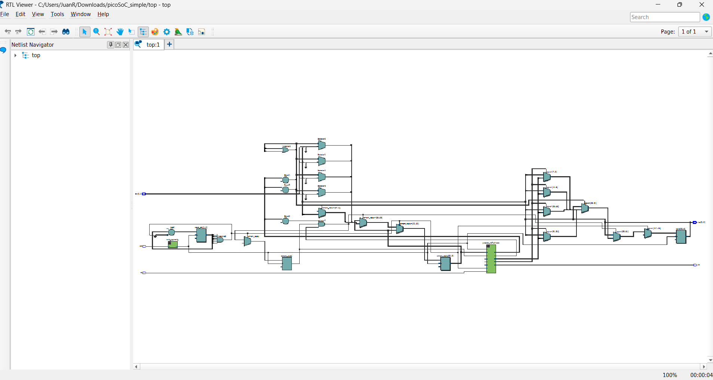
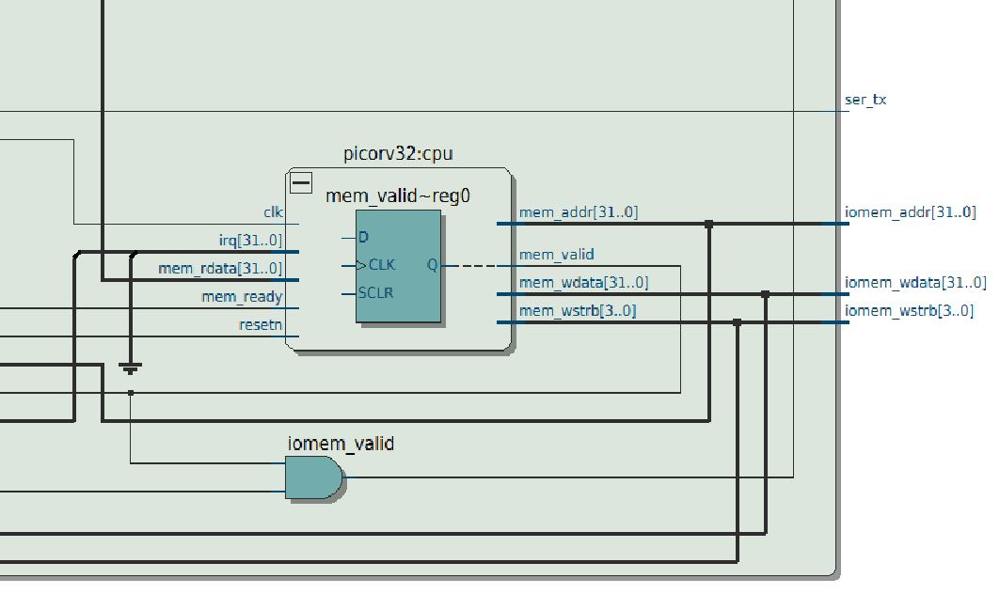
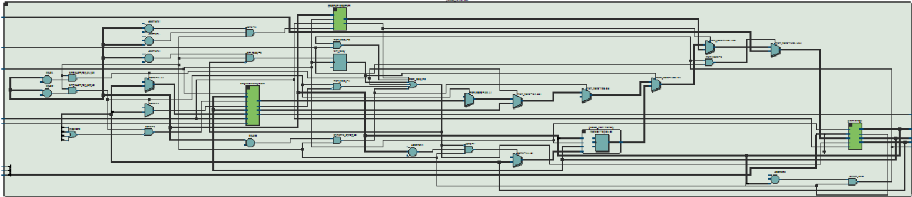

# Lab 06 — PicoSoC con consola de comandos por UART

**Curso:** Arquitectura de procesadores  
**Integrantes:** Juan Pablo Rodríguez Triana, Luis Alejandro Murillo López, Diego Esteban Bravo Velazques  
**Fecha:** 24 de noviembre de 2026  
**Plataforma:** FPGA Intel MAX 10 (DE10-Lite), Intel Quartus Prime Lite 25.1

## 1. Descripción

Este laboratorio implementa un sistema en chip (SoC) con el procesador RISC-V **PicoRV32** en una FPGA MAX 10. El procesador ejecuta un firmware en C que presenta una **consola de comandos por UART**: desde una terminal serial (PuTTY) el usuario escribe un comando, el procesador lo interpreta y actúa sobre los LEDs y los switches de la placa.

Además de los comandos base, el grupo implementó un comando propio: `kitt`, un efecto de luces tipo "Auto Fantástico".

## 2. Arquitectura del SoC

El SoC (`picosoc_noflash.v`) integra:

- **CPU PicoRV32** (`picorv32.v`), ISA RV32IM.
- **ROM de programa** (`progmem.v`), generada automáticamente desde `main.bin` por `progmem.py`.
- **RAM interna** (`picosoc_mem`), para variables y pila.
- **UART** (`simpleuart.v`), para la comunicación serial.
- **GPIO**: salida a LEDs y entrada desde switches.

Los diagramas RTL se generaron en Quartus mediante **Tools > Netlist Viewers > RTL Viewer**.

### Figura 1. Diagrama RTL del nivel superior (`top`)



*Figura 1. Diagrama RTL del nivel superior (`top`) del PicoSoC.*

**Explicación de la Figura 1:**

Esta captura corresponde al RTL Viewer del módulo `top`, que representa el nivel jerárquico superior del diseño. En el panel *Netlist Navigator* de Quartus se identifica el nodo `top`, que es la vista que se está examinando. El área principal presenta la lógica sintetizada y las conexiones que Quartus organiza a partir del código HDL.

Los símbolos y bloques que se observan representan elementos de lógica digital sintetizada, como lógica combinacional, registros y estructuras de conexión. Las líneas representan señales que enlazan esos elementos. Algunas conexiones corresponden a buses, es decir, conjuntos de señales que transportan varios bits. El diagrama se distribuye horizontalmente para acomodar la lógica y sus interconexiones; esa distribución visual no implica necesariamente una secuencia de ejecución de izquierda a derecha.

Esta vista sirve como panorama general de la representación RTL del diseño. Debido a que la lógica sintetizada se presenta en un nivel relativamente detallado, el diagrama puede resultar denso y difícil de interpretar sin acercar la vista o abrir detalles de bloques específicos. Por eso se complementa con las Figuras 2 y 3.

### Figura 2. Detalle del procesador `picorv32:cpu` y su interfaz



*Figura 2. Detalle del RTL: el procesador `picorv32:cpu` y su interfaz.*

**Explicación de la Figura 2:**

Esta captura permite observar el bloque `picorv32:cpu` y algunas de las señales de su interfaz. El PicoRV32 es el núcleo RISC-V de 32 bits que ejecuta las instrucciones del firmware. Las señales visibles permiten sincronizar el procesador, reiniciarlo, recibir datos y coordinar accesos a memoria o al espacio de periféricos.

**Señales de entrada visibles en el diagrama:**

- `clk`: señal de reloj que sincroniza las operaciones secuenciales del procesador.
- `irq[31:0]`: bus de solicitudes de interrupción. La respuesta a las interrupciones depende de la configuración y del firmware.
- `mem_rdata[31:0]`: bus por el que el procesador recibe datos de la interfaz de memoria.
- `mem_ready`: indica que la operación de la interfaz puede completarse, de acuerdo con el protocolo utilizado.
- `resetn`: señal de reinicio activa en nivel bajo.

**Señales de salida visibles en el diagrama:**

- `mem_addr[31:0]`: bus de direcciones que identifica el acceso solicitado.
- `mem_wdata[31:0]`: bus de datos que transporta el valor que se desea escribir.
- `mem_wstrb[3:0]`: indicadores de escritura por byte; cada bit habilita un byte del dato de 32 bits.
- `mem_valid`: señal que indica que se presenta una solicitud válida de acceso a la interfaz.

En la captura, `mem_valid` aparece asociada al registro sintetizado `mem_valid~reg0`. El elemento muestra las conexiones de entrada `D`, `CLK` y `SCLR`, y la salida `Q`. Es una representación de la lógica registrada que Quartus implementó para esa señal; la función exacta del registro depende del HDL sintetizado.

**Interfaz de periféricos:**

En el lado derecho se observan `iomem_addr[31:0]`, `iomem_wdata[31:0]` y `iomem_wstrb[3:0]`. Estas señales corresponden a la interfaz de acceso al espacio de entrada y salida (periféricos). La lógica de interconexión utiliza las direcciones y señales de control para encaminar las operaciones hacia el recurso correspondiente.

También aparece `iomem_valid`, que en el diseño descrito se genera mediante una compuerta AND. Esta lógica participa en la habilitación de las solicitudes dirigidas a la interfaz de periféricos.

Finalmente, `ser_tx` es la señal de transmisión serial de la UART. Permite enviar información desde el sistema hacia el computador, por ejemplo, mensajes de la consola, resultados de operaciones o respuestas a los comandos.

Esta figura es especialmente útil para relacionar las señales del procesador con la forma en que el núcleo se comunica con memorias y periféricos mediante buses y señales de control.

### Figura 3. Diagrama RTL completo del interior del SoC



*Figura 3. Diagrama RTL completo del interior del SoC.*

**Explicación de la Figura 3:**

Esta imagen muestra una vista amplia de la lógica interna del PicoSoC y de las interconexiones entre sus componentes. Se observan diferentes bloques de lógica y conexiones que forman la estructura sintetizada del sistema. La captura permite apreciar que el procesador forma parte de una arquitectura integrada y que necesita comunicarse con memorias y periféricos mediante señales de datos, direcciones y control.

Los componentes funcionales principales del SoC, descritos en el diseño, son:

- **CPU PicoRV32:** ejecuta las instrucciones del firmware, realiza operaciones y controla las solicitudes de acceso a los recursos del sistema.
- **ROM de programa (`progmem`):** contiene las instrucciones del firmware que el procesador ejecuta.
- **RAM interna:** almacena datos temporales, variables y la pila durante la ejecución.
- **UART (`simpleuart.v`):** permite recibir caracteres desde el computador y transmitir las respuestas del sistema.
- **GPIO:** conecta el sistema con las entradas y salidas digitales utilizadas para leer switches y controlar LEDs.

Las líneas del diagrama representan interconexiones entre la lógica. Pueden transportar datos, direcciones o señales de control. La cantidad de líneas y sus cruces hacen que la vista resulte visualmente compleja; no obstante, estas conexiones son parte de la estructura que permite coordinar las operaciones de los distintos componentes.

Los bloques de color o su forma gráfica, por sí solos, no bastan para identificar de manera inequívoca cada elemento como RAM, ROM o una función lógica específica. La identificación exacta requiere consultar las etiquetas o abrir el elemento correspondiente en Quartus.

**Relación con el funcionamiento del laboratorio:** cuando el usuario escribe un comando en PuTTY, la UART recibe los caracteres. El firmware ejecutado por el PicoRV32 interpreta el comando y, según corresponda, utiliza la interfaz de periféricos para escribir el registro de LEDs o leer el registro de switches. Si se trata de una operación como `calc`, el procesador realiza los cálculos y devuelve el resultado por UART. Esta arquitectura integrada permite que el programa en C interactúe con los elementos físicos de la FPGA.

### Comparación de las tres figuras

| Figura | Vista | Qué permite comprender |
|---|---|---|
| Figura 1 | Nivel superior (`top`) | Panorama general de la lógica RTL sintetizada y sus interconexiones. |
| Figura 2 | Interfaz del `picorv32:cpu` | Señales de entrada y salida, buses de memoria y lógica de validación de acceso a periféricos. |
| Figura 3 | Interior completo del SoC | La estructura integrada y las interconexiones entre los componentes del sistema. |

## 3. Mapa de memoria

| Región / periférico | Dirección base | Tamaño / registro | Descripción |
|---|---|---|---|
| RAM | `0x00000000` | 1 KB (`0x400`) | Variables y pila. La pila inicia en `4*MEM_WORDS` = `0x400` y crece hacia abajo. |
| ROM de programa (`progmem`) | `0x00100000` | 16 KB (`0x4000`) | Contiene el firmware. El procesador arranca en esta dirección (`PROGADDR_RESET`). |
| UART — divisor de baudios | `0x02000004` | 32 bits, escritura | Se escribe `CLK_FREQ / BAUD_RATE` = 50 000 000 / 115 200 ≈ 434. |
| UART — datos | `0x02000008` | 32 bits | Escritura: transmite un byte. Lectura: devuelve el byte recibido, o `-1` (todos los bits en 1) si no hay dato. |
| LEDs | `0x03000000` | 32 bits, escritura | Cada bit enciende un LED. El firmware usa los LEDs 0 a 3. |
| Switches | `0x03000004` | 32 bits, lectura | Cada bit refleja un switch. El firmware lee los switches 0 a 3. |

## 4. Herramientas y flujo de compilación

- **MSYS2 MinGW 64-bit** como terminal de desarrollo.
- **Toolchain RISC-V:** xPack `riscv-none-elf-gcc` 15.2.0, instalado en `C:\tools\riscv`.
- **Quartus Prime Lite 25.1std** para la síntesis.

Flujo desde la terminal MSYS2 MinGW 64-bit:

```bash
export PATH="/c/tools/riscv/bin:$PATH"
export PATH=/c/altera_lite/25.1std/quartus/bin64:$PATH

git clone https://github.com/digital-ECCI/picoSoC_simple.git
cd picoSoC_simple

make                        # compila main.c -> main.bin y genera progmem.v
make build TARGET=max10     # síntesis en Quartus (map, fit, asm) -> output_files/top.sof
make program TARGET=max10   # carga el .sof en la FPGA
```

Para el diagrama RTL: `quartus --64bit top.qpf` y luego **Tools > Netlist Viewers > RTL Viewer**.

Al compilar con la configuración final, `main.bin` ocupa **4160 bytes**.

## 5. Comandos de la consola

Al arrancar aparece el banner `picoSoC Shell` y el prompt `> `. Los LEDs y switches se numeran desde 0.

| Comando | Descripción | Ejemplo |
|---|---|---|
| `help` | Lista los comandos disponibles. | `help` |
| `about` | Muestra información del sistema. | `about` |
| `clear` | Limpia la pantalla de la terminal. | `clear` |
| `led <n> <on\|off>` | Enciende o apaga el LED `n` (0–3). | `led 2 on` |
| `leds <valor>` | Pone los 4 LEDs según un valor, en decimal (0–15) o hexadecimal (`0x0`–`0xF`). | `leds 0xA` |
| `sw` | Lee y muestra el estado de los switches 0–3. | `sw` |
| `blink <n> <veces>` | Parpadea el LED `n`, entre 1 y 20 veces, con retardo por software. | `blink 1 5` |
| `calc <a> <op> <b>` | Opera dos enteros decimales con `+`, `-`, `*` o `/` (división entera). Detecta la división por cero. | `calc 6 * 7` |
| `kitt [vueltas]` | **Comando propio.** Efecto "Auto Fantástico" (ver sección 6). | `kitt 3` |

Ejemplo de sesión:

```
> led 3 on
ok
> calc 6 * 7
6 * 7 = 42
> sw
Switches = 0x05  (S3:0 S2:1 S1:0 S0:1)
> kitt 2
KITT en marcha (cualquier tecla para detener)...
listo
```

## 6. Comando propio: `kitt`

**Sintaxis:** `kitt [vueltas]` — de 1 a 50 vueltas; por defecto 3.

**Funcionamiento:** un solo LED se desplaza de un extremo al otro y regresa, como el scanner del Auto Fantástico. Una vuelta recorre los LEDs 0 → 1 → 2 → 3 → 2 → 1. El movimiento se detiene automáticamente al terminar las vueltas.

**Decisiones de diseño:**

- **Se puede detener con cualquier tecla.** En cada paso se consulta la UART con `uart_getchar_nb()` (lectura no bloqueante). Si hay un byte, el efecto se detiene y se imprime `detenido`.
- **Restaura el estado previo.** Antes de empezar se guarda `led_state` y al terminar se escribe de nuevo, para no alterar lo que hubiera encendido con los comandos `led` o `leds`.
- **Validación de argumentos.** Si el número de vueltas no es válido o está fuera de rango, muestra `uso: kitt [vueltas 1-50]`.
- **Retardo por software.** Cada paso usa `delay_cycles(150000)`.

## 7. Decisiones de implementación

1. **Optimización `-Os`.** El `Makefile` original compilaba sin optimización y el firmware no cabía en la memoria: el enlazador reportaba `region FLASH overflowed by 6168 bytes`. Se agregó `-Os` a la línea de compilación de `main.elf`, lo que redujo el exceso a 3696 bytes (todavía insuficiente por sí solo; ver punto 3).
2. **Tabla hexadecimal `static const`.** Con `-Os`, la tabla local de dígitos de `uart_put_hex` generaba una llamada a `memcpy`, que no existe porque se compila con `-nostdlib`. Se declaró `static const char hex[]`, de modo que queda en memoria de solo lectura y no se copia.
3. **Ampliación de memoria.** El `sections.lds` original definía solo 512 bytes de programa (`FLASH`) y 128 bytes de RAM, valores de un ejemplo mínimo. El firmware (≈4 KB) y su pila no caben, así que se ampliaron de forma coherente en el linker y en el hardware:

   | Archivo | Cambio |
   |---|---|
   | `sections.lds` | `FLASH` `LENGTH` `0x200` → `0x4000` (16 KB); `RAM` `LENGTH` `0x80` → `0x400` (1 KB) |
   | `progmem.py` | `MEM_SIZE_BITS` `10` → `12` (4096 palabras = 16 KB) |
   | `picosoc_noflash.v` | `MEM_WORDS` `32` → `256` (1 KB de RAM) |

   La pila (`STACKADDR = 4*MEM_WORDS`) y la inicialización de RAM de `start.s` se ajustan solas con `MEM_WORDS`.
4. **ISA RV32IM.** Se compila con `-march=rv32im`, por lo que las operaciones `*`, `/` y `%` de `calc` usan las instrucciones de multiplicación y división del procesador.
5. **Estado local de los LEDs.** El firmware mantiene una copia (`led_state`) de lo que se escribe en el registro de LEDs, para poder modificar un solo bit sin perder los demás.
6. **Entrada por UART.** `readline` hace eco de los caracteres, admite retroceso (borrar) y descarta caracteres no imprimibles; `tokenize` divide la línea en palabras separadas por espacios.

## 8. Resultados y evidencias

- **Diagramas RTL:** se incluyen las tres capturas del RTL Viewer y sus explicaciones en la sección 2: nivel superior (`figs/rtl_top.png`), interfaz del CPU (`figs/rtl_cpu.png`) e interior del SoC (`figs/rtl_soc.png`).
- **Resumen de síntesis en Quartus:** Analysis & Synthesis, Fitter y Assembler terminaron con 0 errores y generaron `output_files/top.sof`.

Configuración de PuTTY: conexión **Serial**, puerto COM del adaptador USB-serial, **115200** baudios, 8 bits de datos, sin paridad, 1 bit de parada.

## 9. Problemas encontrados

| Problema | Causa | Solución |
|---|---|---|
| `region FLASH overflowed` al compilar | Compilación sin optimización y `FLASH` de solo 512 bytes | `-Os` y ampliación de memoria (sección 7) |
| `undefined reference to memcpy` | Tabla local en `uart_put_hex` con `-nostdlib` | `static const char hex[]` |
| `pacman` fallaba con `Operation too slow` | Servidores de paquetes lentos | `pacman -S --disable-download-timeout ...` |
| `quartus_sh: command not found` | En Quartus 25.1 los ejecutables están en `bin64` y no en `bin` | Usar `.../quartus/bin64` en el `PATH` |

## 10. Referencias

- Repositorio base: <https://github.com/digital-ECCI/picoSoC_simple>
- PicoRV32: <https://github.com/YosysHQ/picorv32>
- Guía del laboratorio 06 (curso).
